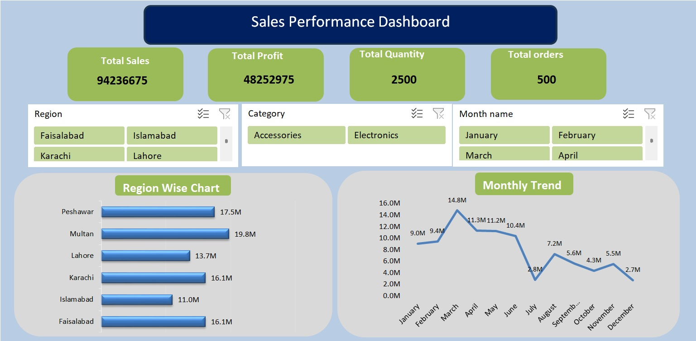

# 📊 Excel Sales Performance Dashboard

### Interactive Sales Performance Dashboard built in Excel using Pivot Tables, Slicers, Region-wise and Monthly Trend charts.

This project provides a complete overview of Total Sales, Profit, and Regional Performance.

---

### 📸 Dashboard Preview

---

### 📌 Key Features
- **KPI Cards:** Total Sales, Total Profit, Total Orders
- **Regional Analysis:** Identified **Multan** as the Top Performing Region
- **Monthly Trend Analysis:** Sales & Profit trend over time
- **Interactive Slicers:** Filter by Region, Category, and Payment Method
- **Dynamic Charts:** Region-wise Bar Chart & Monthly Line Chart

### 🛠️ Tools Used
- Microsoft Excel
- Pivot Tables & Pivot Charts
- Slicers
- Conditional Formatting
- Data Cleaning & Validation

### 📂 Files in this Repo
- `Excel-sales-performance-dashboard.xlsx` - Complete working dashboard file
- `screenshots/` - High-quality dashboard preview image

### 👩‍💻 About Me
I am a Data Analyst | Excel & Power BI Enthusiast.
I transform raw data into actionable insights and interactive dashboards.

**Need a custom dashboard for your business? Let's connect on Fiverr!**

🔗 GitHub: https://github.com/tahira-data-analyst/excel-sales-performance-dashboard
